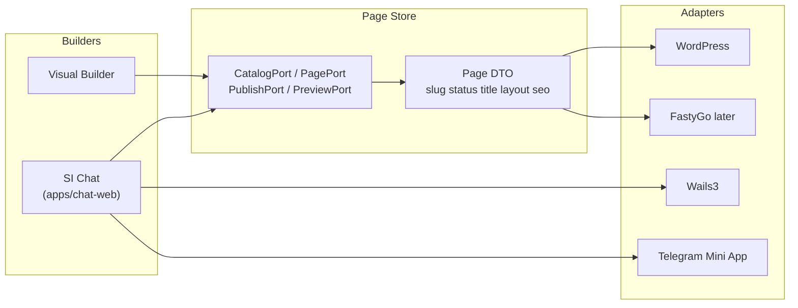

# Architecture

SI Chat is a **CMS-agnostic** website builder. The same ordinary pages (`page` + unique slug) are edited by two UIs that share one **Page Store**.

## Dual builders

- **Visual Builder** (separate product) writes layout blocks.
- **SI Chat** (`apps/chat-web`) is a Lovable-like chat with a history sidebar. It proposes the same Page DTO; it does not import WordPress PHP.
- Adapters implement the ports. WordPress is a thin plugin that embeds the Svelte bundle and REST. Wails3 and Telegram Mini App host the same SPA.

P0 pages are ordinary pages only: unique slug, no multilanding/UTM, no checkout/payment, no fabricated discounts or stock.

## Runtime split

| Piece | Role | Status in this repo |
| --- | --- | --- |
| `apps/chat-web` | SvelteKit SPA: sidebar, thread, composer, dark/light, ru strings | **runnable** (`npm run dev` / `build`) |
| `apps/orchestrator` | `@grok/agent-sdk@0.6.0` bot | stub (no live keys) |
| `services/context-serve` | Go CR wrapper (`github.com/buildytech/chat/services/context-serve`) | stub |
| `packages/page-contract` | Page DTO | types |
| `packages/ports` | Catalog / Page / Publish / Preview | types |
| `adapters/wordpress` | Embed SPA + PagePort REST | stub PHP + TS client |
| `adapters/wails3` | Desktop webview | stub |
| `adapters/telegram-mini` | Mini App host | stub |

## Chat-web UI

Figma "Chat Preview Site" is **layout reference only** (desktop sidebar ~248px + content; 768/360 use a 64px navigate bar). Implementation uses **UI8Kit Svelte** primitives (`tag` retag, no bare HTML in composition), **Istok Web** (local), **rounded-default**, **shadcn HSL tokens**, Lucide icons, dictionary strings (ru).

**Creator surfaces** (see [ADR-0003](../.project/adr/0003-creator-surfaces-preview-code.md)): ChatCore (no DOM) · ChatColumn · CreatorShell (AppNav \| chat \| Workspace). Workspace is the current page BlockTree with Preview (Svelte) and Code (Latte stub) tabs — both from one Page DTO. Hosts compose differently (SPA = full shell; WP embed = ChatColumn ± chrome).

Offline mock: ChatCore / `src/lib/api/session.svelte.ts` (in-memory + localStorage). The SPA does not call a live orchestrator. Agent Gateway, AdapterRegistry (`context-local` default, opt-in `cursor-sdk`) are [ADR-0004](../.project/adr/0004-agent-runtime-adapters.md) — not wired in P0.

## License

Copyright holder: **BuildYtech**. Apache-2.0 at the repository root.
