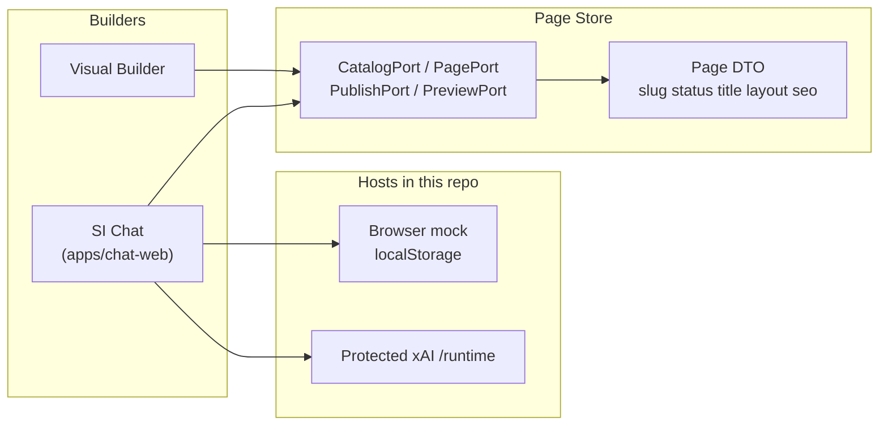

# Architecture

SI Chat is a **CMS-agnostic** website builder. The same ordinary pages (`page` + unique slug) are edited by two UIs that share one **Page Store**. BuildY is **one product** on three hosts (WordPress builder page, Browser, Desktop Wails3) with one pinned CodeGen-X Stock catalog ([ADR-0007](../.project/adr/0007-one-buildy-three-hosts.md), [plan](plans/one-buildy-three-hosts.md)). This repo's **active, in-tree** target is the **browser Creator SPA**; finish that before Wails3. WordPress is not a runtime here (ADR-0006). Portable export/import is planned, not implemented.

## Dual builders

- **Visual Builder** (separate product) writes layout blocks.
- **SI Chat** (`apps/chat-web`) is a Lovable-like chat with a history sidebar. It proposes the same Page DTO.
- Ports stay framework-neutral. Host adapters implement them later. `published` on the DTO is a domain status, not a CMS product.

P0 pages are ordinary pages only: unique slug, no multilanding/UTM, no checkout/payment, no fabricated discounts or stock.

## Runtime split

| Piece | Role | Status in this repo |
| --- | --- | --- |
| `apps/chat-web` | SvelteKit SPA: CreatorShell (nav \| chat \| Preview/Code) | **runnable default** — mock ChatCore (`npm run dev` / `build`) |
| `apps/xai-runtime` | Protected Grok `/runtime` | optional; server `XAI_API_KEY` |
| `services/context-serve` | Retired CI placeholder | not a Session HTTP product |
| `packages/page-contract` | Page DTO | types + runtime validator (`layout.version` 1) |
| `packages/ports` | Catalog / Page / Publish / Preview | types |

WordPress plugin/embed is **not** in this repository. Code is Svelte UI8Kit, not Latte. `services/context-serve` is a retired CI placeholder. Historical dual-host notes: [ADR-0001](../.project/adr/0001-cms-agnostic-chat-builder.md) (WP embed host superseded by [ADR-0006](../.project/adr/0006-browser-first-no-wordpress-runtime.md); three-host product: [ADR-0007](../.project/adr/0007-one-buildy-three-hosts.md)).

## Chat-web UI

Figma "Chat Preview Site" is **layout reference only** (desktop sidebar ~248px + content; 768/360 use a 64px navigate bar). Implementation uses **UI8Kit Svelte** primitives (`tag` retag, no bare HTML in composition), **Istok Web** (local), **rounded-default**, **shadcn HSL tokens**, Lucide icons, dictionary strings.

**Creator surfaces** (see [ADR-0003](../.project/adr/0003-creator-surfaces-preview-code.md)): ChatCore (no DOM) · ChatColumn · CreatorShell (AppNav \| chat \| Workspace). Workspace is the current page BlockTree with Preview (Svelte) and Code (Svelte UI8Kit source) tabs — both from one Page DTO.

Default ChatCore is **mock** (localStorage). Protected Grok uses `/runtime`. See [live-model-local.md](live-model-local.md) for historical Session HTTP notes.

## License

Copyright holder: **BuildYtech**. Apache-2.0 at the repository root.
