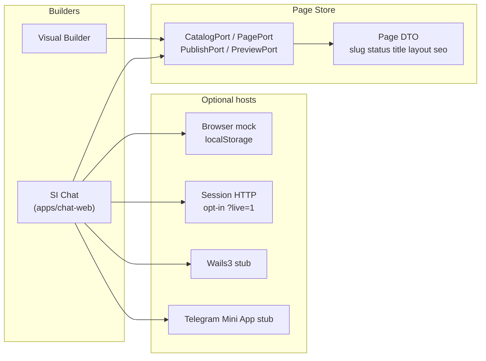

# Architecture

SI Chat is a **CMS-agnostic** website builder. The same ordinary pages (`page` + unique slug) are edited by two UIs that share one **Page Store**. This repo's active target is the **browser Creator SPA**.

## Dual builders

- **Visual Builder** (separate product) writes layout blocks.
- **SI Chat** (`apps/chat-web`) is a Lovable-like chat with a history sidebar. It proposes the same Page DTO.
- Ports stay framework-neutral. Host adapters implement them later. `published` on the DTO is a domain status, not a CMS product.

P0 pages are ordinary pages only: unique slug, no multilanding/UTM, no checkout/payment, no fabricated discounts or stock.

## Runtime split

| Piece | Role | Status in this repo |
| --- | --- | --- |
| `apps/chat-web` | SvelteKit SPA: CreatorShell (nav \| chat \| Preview/Code) | **runnable default** — mock ChatCore (`npm run dev` / `build`) |
| `apps/orchestrator` | `@grok/agent-sdk@0.6.0` bot | optional stub (no live keys; not default) |
| `services/context-serve` | Go PagePort + Session HTTP (SQLite) | optional stub; opt-in from the SPA with `?live=1` |
| `packages/page-contract` | Page DTO | types + runtime validator (`layout.version` 1) |
| `packages/ports` | Catalog / Page / Publish / Preview | types |
| `adapters/wails3` | Desktop webview | stub |
| `adapters/telegram-mini` | Mini App host | stub |

WordPress plugin/embed is **not** in this repository. Historical dual-host notes: [ADR-0001](../.project/adr/0001-cms-agnostic-chat-builder.md) (superseded in part by [ADR-0006](../.project/adr/0006-browser-first-no-wordpress-runtime.md)).

## Chat-web UI

Figma "Chat Preview Site" is **layout reference only** (desktop sidebar ~248px + content; 768/360 use a 64px navigate bar). Implementation uses **UI8Kit Svelte** primitives (`tag` retag, no bare HTML in composition), **Istok Web** (local), **rounded-default**, **shadcn HSL tokens**, Lucide icons, dictionary strings.

**Creator surfaces** (see [ADR-0003](../.project/adr/0003-creator-surfaces-preview-code.md)): ChatCore (no DOM) · ChatColumn · CreatorShell (AppNav \| chat \| Workspace). Workspace is the current page BlockTree with Preview (Svelte) and Code (Latte stub) tabs — both from one Page DTO.

Default ChatCore is **mock** (localStorage + North Harbor fixture when a session is selected). Optional `?live=1` talks to Session HTTP through the Vite `/v1` proxy. Deterministic `PlanTurn` stays the stub builder on that path. Opt-in `BUILDY_LIVE_MODEL=1` on context-serve is **not** part of the default start and is not a paid smoke in this repo. See [live-model-local.md](live-model-local.md) and [cr-port-provenance.md](cr-port-provenance.md).

## License

Copyright holder: **BuildYtech**. Apache-2.0 at the repository root.
