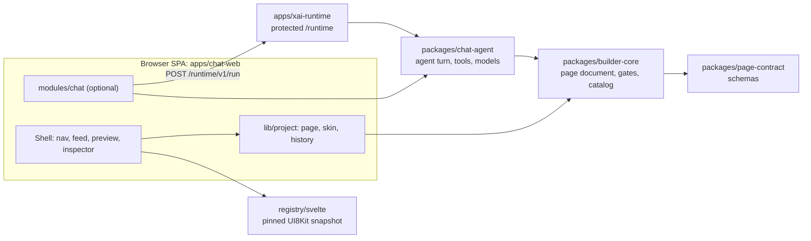

# Architecture

BuildY Chat is a browser-first website creator. A page is a document of UI8Kit registry blocks; the author assembles it from the Stock catalog, edits schema-backed fields in the inspector, and optionally asks a model for help. BuildY is one product on three hosts (WordPress builder page, Browser, Desktop Wails3) over one pinned Stock catalog ([ADR-0007](../.project/adr/0007-one-buildy-three-hosts.md), [plan](plans/one-buildy-three-hosts.md)); this repository implements the **Browser** host. WordPress is not a runtime here ([ADR-0006](../.project/adr/0006-browser-first-no-wordpress-runtime.md)).

## Pieces

| Piece | Role |
| --- | --- |
| `apps/chat-web` | SvelteKit static SPA (adapter-static). The core shell (nav, Blocks feed, Sections, Inspector, preview, project store) imports no chat code. |
| `apps/chat-web/src/modules/chat` | The chat as an optional module behind a `BuilderModule` port ([ADR-0041](../.project/adr/0041-chat-as-optional-module.md)). `VITE_MODULE_CHAT=0` folds it out of the bundle; `npm run modules:check:trace` proves no trace is left. |
| `packages/builder-core` | The page document (`page-doc`), edit operations and their gates (document schema, props gate, render probe), the Stock catalog snapshot and search. No model dependencies. |
| `packages/chat-agent` | The agent turn and its tools (`write_page`, `get_page`, `search_catalog`, `get_block`), model resolution, usage, runtime environment and protection. |
| `apps/xai-runtime`, `api/runtime` | Protected server runtime (`/runtime/v1/status`, `/runtime/v1/run`); Vercel Functions in staging. `XAI_API_KEY` stays server-side. |
| `packages/page-contract` | JSON Schemas and validators: the page-spec 2.0 document and the portable session `buildy:v2` (@ui8kit/contract 0.5.0). |
| `packages/ports` | Framework-neutral Catalog, Page, Publish and Preview port types. |
| `registry/svelte` | The pinned `npx ui8kit init` + `add --all` snapshot, the single source of UI ([ADR-0008](../.project/adr/0008-registry-single-source-of-ui.md)). Never hand-edited. |
| `catalog/` | The pinned Stock plus registry graph and its derived artifacts ([ADR-0012](../.project/adr/0012-unified-catalog-snapshot.md), [0039](../.project/adr/0039-one-block-source.md)). |
| `services/context-serve` | Retired CI placeholder; not a product. |

## Data and gates

- **Page** ([ADR-0034](../.project/adr/0034-page-spec-2-one-write-tool.md)): `{title, slug, locale, seo, blocks:[{id, item, variant, props}]}`; `item` is the `npx ui8kit add` registry name. Hard rules only: the document schema, the props schema, a renderer exists. Free composition ([ADR-0037](../.project/adr/0037-free-page-composition.md)).
- **Every write** (inspector, feed, agent, import) passes the same gates, fails closed, and reports `{path, code, expected, got}`: document schema, props gate (Ajv 2020 strict over the pinned props schemas, [ADR-0010](../.project/adr/0010-props-schemas-program-gate.md)) and the render probe, which renders each added or changed block and refuses a throw or an empty result ([ADR-0035](../.project/adr/0035-render-probe-gate.md), [0038](../.project/adr/0038-one-render-probe.md)).
- **Storage** ([ADR-0015](../.project/adr/0015-session-standard-buildy-v1.md), [0040](../.project/adr/0040-session-split-project-and-chat.md), [0044](../.project/adr/0044-chat-keys-in-ext.md)): everything under `buildy:v1:*` in the browser, validated at load; the session is a project plus `ext.chat`. Old data is refused and set aside, never converted ([ADR-0045](../.project/adr/0045-remove-old-data-paths.md)).
- **Chat** ([ADR-0011](../.project/adr/0011-ask-build-modes-shared-agent-tools.md), [0020](../.project/adr/0020-ask-plan-apply-in-build.md), [0018](../.project/adr/0018-build-self-correction.md)): Ask is read-only and proposes; Build writes through one tool. Nothing calls a model until the author sends a message.
- **Preview and Code** both derive from the one page document: Preview renders the registry components, Code is the generated Svelte UI8Kit source and the ZIP export identical to the CLI install.
- **Quality gate** ([ADR-0042](../.project/adr/0042-quality-gate.md), [0043](../.project/adr/0043-security-gate.md)): `npm run verify`; ratchets only go down.

## UI

Figma "Chat Preview Site" is a layout reference only ([fig-ref](fig-ref.md)). The shell is UI8Kit composition ([ADR-0028](../.project/adr/0028-chat-ui-refinement.md)): registry components with `tag` retag, Istok Web, `rounded-default`, shadcn HSL tokens, dictionary strings. Compact IDE layout with resizable panes ([ADR-0017](../.project/adr/0017-ide-layout-resizable-panes.md)); below `lg` tabs switch the panes.

P0 pages are ordinary pages: unique slug, no multilanding or UTM, no checkout or payment, no fabricated discounts or stock.

## License

Copyright holder: **BuildYtech**. Apache-2.0 at the repository root.
